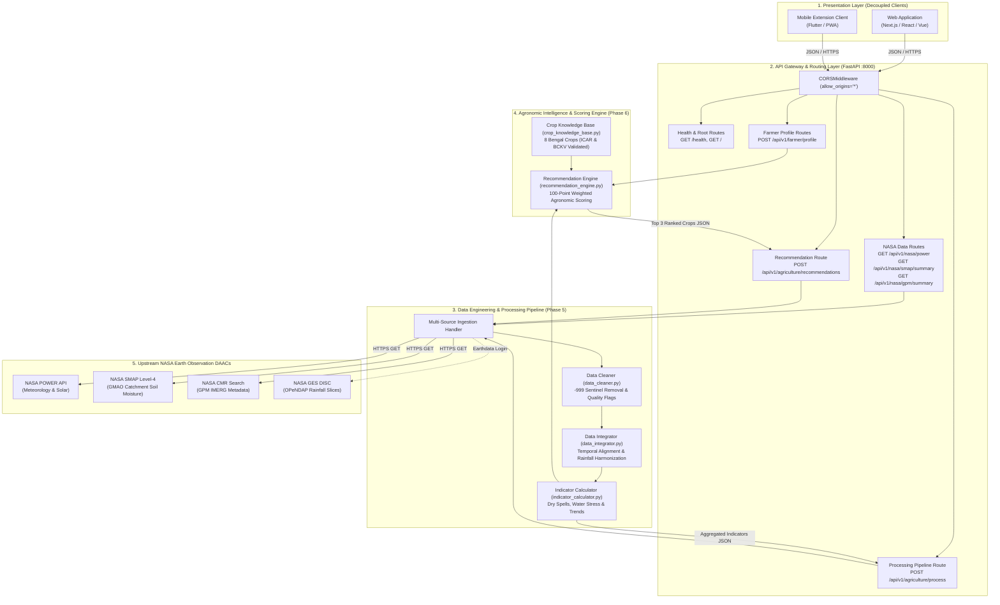
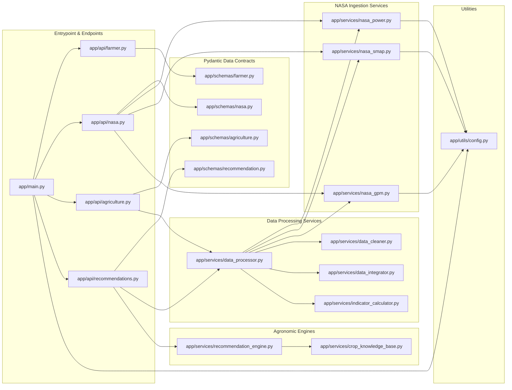
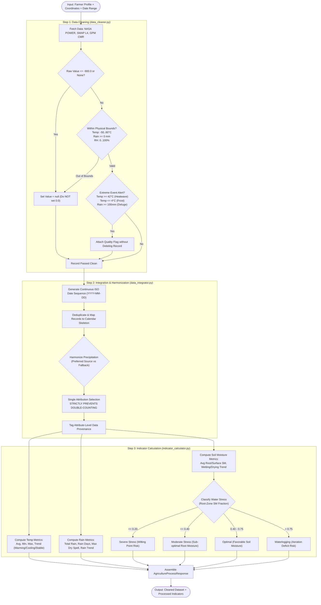
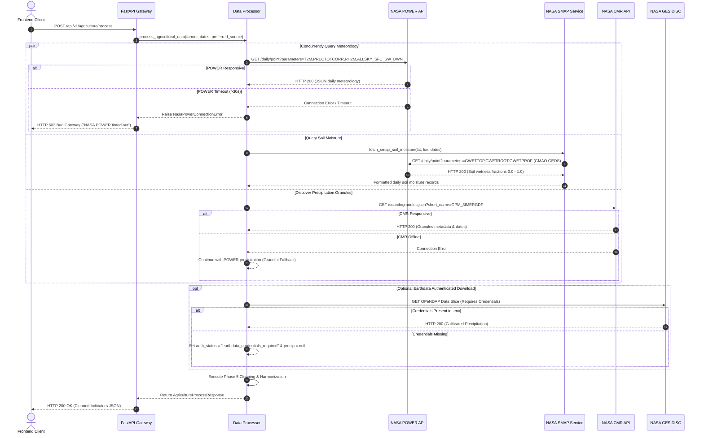
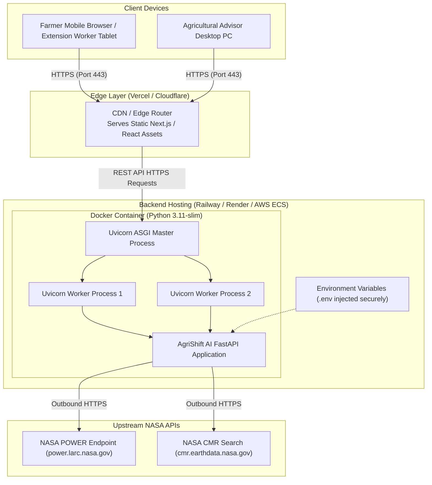

# Complete Technical Architecture & System Blueprint
## AgriShift AI: NASA-Powered Smart Agriculture & Crop Planning Platform

---

### Document Metadata
* **Document Version:** 2.0.0 (Enhanced Architectural Blueprint)
* **System Classification:** Stateless RESTful Agro-Climatic Intelligence Service
* **Primary Language & Runtime:** Python 3.10+ (Tested on Python 3.14.7)
* **Core Framework:** FastAPI + Pydantic v2 + Uvicorn
* **Target Geographical Scope:** Hooghly District, West Bengal, India (22.90°N, 88.40°E)
* **Author:** Senior System Architect & Technical Documentation Engineer

---

## 1. Architectural Philosophy & Design Principles

AgriShift AI is engineered around five fundamental software engineering principles tailored for smallholder agricultural advisory systems:

1. **Stateless Microservice Design:** The backend requires no relational or document database to calculate recommendations. Every request is self-contained, taking farmer inputs, querying live spaceborne observations, executing in-memory cleaning and integration, and returning actionable agronomic advisories within < 3 seconds.
2. **Decoupled Architecture:** The backend API and client presentation layer are 100% decoupled. The backend exposes standard OpenAPI/Swagger-compliant JSON contracts, enabling any frontend (Next.js, React, Streamlit, mobile Android) to consume it seamlessly.
3. **Data Provenance & Scientific Transparency:** Satellite measurements are never fabricated. Missing satellite pixels are flagged as `null` (never coerced to `0.0`). Every parameter in response payloads retains metadata regarding its satellite sensor, resolution, and observation date.
4. **Deterministic & Explainable Agronomy:** Rather than uninterpretable "black-box" machine learning models that can hallucinate dangerous advice in volatile weather, AgriShift AI implements deterministic, multi-factor agronomic scoring rules codified by the **Indian Council of Agricultural Research (ICAR)** and **Bidhan Chandra Krishi Viswavidyalaya (BCKV)**.
5. **Resilient Upstream Failover:** Upstream NASA timeouts or missing DAAC credentials degrade gracefully with transparent status indicators (`"earthdata_credentials_required"`) and standard HTTP status codes (400, 422, 502) rather than unhandled server crashes.

---

## 2. Complete Project Directory & File-by-File Blueprint

The repository follows a clean, modular layout where concerns are strictly separated into API routing, Pydantic schemas, external connectors, data processing pipelines, agronomic knowledge bases, and automated verification suites.

### 2.1 Annotated Directory Tree

```text
Agrishhift AI/
│
├── app/                                    # Core Application Package
│   ├── __init__.py                         # Package initialization marker
│   ├── main.py                             # FastAPI entrypoint, middleware, and route mounting
│   │
│   ├── api/                                # REST Route Controllers (Layer 1)
│   │   ├── __init__.py                     # API package initialization
│   │   ├── farmer.py                       # Farmer profile submission & validation endpoints
│   │   ├── nasa.py                         # NASA POWER, SMAP, and GPM query endpoints
│   │   ├── agriculture.py                  # Phase 5 data cleaning & processing endpoint
│   │   └── recommendations.py              # Phase 6 crop recommendation advisory endpoints
│   │
│   ├── schemas/                            # Pydantic v2 Data Models & Contracts (Layer 2)
│   │   ├── __init__.py                     # Schemas package initialization
│   │   ├── farmer.py                       # Farmer profile input/response validation models
│   │   ├── nasa.py                         # NASA Earth Observation response schemas & metadata
│   │   ├── agriculture.py                  # Phase 5 pipeline request/response schemas
│   │   └── recommendation.py               # Phase 6 crop recommendation output schemas
│   │
│   ├── services/                           # Business Logic & Analytical Engines (Layer 3)
│   │   ├── __init__.py                     # Services package initialization
│   │   ├── nasa_power.py                   # NASA POWER Daily API client (Meteorology & Solar)
│   │   ├── nasa_smap.py                    # NASA SMAP Level-4 soil moisture assimilation client
│   │   ├── nasa_gpm.py                     # NASA GPM IMERG CMR search & OPeNDAP client
│   │   ├── data_cleaner.py                 # Sentinel (-999) sanitization, quality flagging
│   │   ├── data_integrator.py              # Date alignment & rainfall harmonization
│   │   ├── indicator_calculator.py         # Dry spells, water-stress, trends & indicators
│   │   ├── data_processor.py               # Phase 5 pipeline orchestrator
│   │   ├── crop_knowledge_base.py          # Agronomic knowledge base for 8 Hooghly crops
│   │   └── recommendation_engine.py        # Phase 6 100-point multi-factor recommendation engine
│   │
│   └── utils/                              # Infrastructure & Utilities (Layer 4)
│       ├── __init__.py                     # Utils package initialization
│       └── config.py                       # Pydantic Settings & environment variable loader
│
├── data/                                   # Local Data Storage
│   └── .gitkeep                            # Placeholder for temporary downloads or cache
│
├── docs/                                   # Complete Technical Documentation Suite
│   ├── README.md                           # Documentation directory index & system overview
│   ├── API_DOCUMENTATION.md                # Comprehensive Frontend API reference & contracts
│   ├── BACKEND_SETUP.md                    # Windows developer setup & execution manual
│   ├── DATA_PIPELINE.md                    # Phase 5 data cleaning, integration & indicator formulas
│   ├── CROP_RULES_REFERENCE.md             # 8-crop knowledge base, 100-pt scoring & ICAR sources
│   ├── AGRONOMIC_VALIDATION.md             # Scientific validation, ICAR/BCKV rules & limits
│   ├── FINAL_BACKEND_AUDIT.md              # Final implementation audit scorecard & evidence
│   ├── ARCHITECTURE.md                     # Complete Technical Architecture (This Document)
│   ├── API_REFERENCE.md                    # Detailed API Endpoints & cURL Reference
│   ├── FRONTEND_HANDOVER.md                # Frontend Developer Handover & UI Specifications
│   └── PRD.md                              # Product Requirements Document
│
├── tests/                                  # Automated Pytest Verification Suite (92 Tests)
│   ├── __init__.py                         # Test package marker
│   ├── test_health.py                      # Health check & root endpoint tests (2 tests)
│   ├── test_farmer_schema.py               # Farmer input validation & edge-case tests (13 tests)
│   ├── test_nasa_power.py                  # NASA POWER API client & summary tests (17 tests)
│   ├── test_nasa_smap.py                   # NASA SMAP soil moisture tests (9 tests)
│   ├── test_nasa_gpm.py                    # NASA GPM CMR, auth & fallback tests (16 tests)
│   ├── test_data_processor.py              # Phase 5 data cleaning & integration tests (15 tests)
│   └── test_recommendation_engine.py       # Phase 6 recommendation & agronomic tests (20 tests)
│
├── .env                                    # Local environment secrets (Git-ignored)
├── .env.example                            # Safe template with placeholders only
├── .gitignore                              # Git exclusion rules (Secrets, cache, virtualenvs)
├── requirements.txt                        # Production package dependencies
└── README.md                               # Project overview and quickstart instructions
```

---

### 2.2 In-Depth File Responsibilities Matrix

| File Path | Primary Responsibility | Key Classes / Functions | Upstream / Downstream Dependencies |
|---|---|---|---|
| `app/main.py` | FastAPI application instance, CORS configuration, and router aggregation. | `app`, `root()`, `health_check()` | Imports `app.api.*` routers and mounts them at `/` and `/api/v1`. |
| `app/api/farmer.py` | Route controller for farmer profile intake. | `submit_farmer_profile()`, `get_farmer_service_status()` | Uses `FarmerProfileBase` schema from `app/schemas/farmer.py`. |
| `app/api/nasa.py` | Route controller for direct satellite data endpoints. | `get_nasa_power_data()`, `get_nasa_power_summary()`, `get_nasa_gpm_summary()`, `get_nasa_smap_summary()` | Calls `nasa_power.py`, `nasa_smap.py`, `nasa_gpm.py`; validates with `schemas/nasa.py`. |
| `app/api/agriculture.py` | Route controller for Phase 5 data processing. | `process_agriculture_endpoint()` | Calls `data_processor.process_agricultural_data()`; uses `schemas/agriculture.py`. |
| `app/api/recommendations.py` | Route controller for Phase 6 crop recommendations. | `get_crop_recommendations_endpoint()`, `get_recommendations_status()` | Calls `data_processor.py` and `recommendation_engine.py`; uses `schemas/recommendation.py`. |
| `app/schemas/farmer.py` | Pydantic validation schema for farm characteristics. | `FarmerProfileBase`, `FarmerProfileResponse` | Enforces coordinates (-90..90, -180..180), acreage (>0), strings min_length 1. |
| `app/schemas/nasa.py` | Pydantic response models for satellite time series. | `NasaPowerResponse`, `NasaPowerSummaryResponse`, `NasaGpmSummaryResponse`, `NasaSmapSummaryResponse` | Defines units, metadata, daily points, and statistical summary schemas. |
| `app/schemas/agriculture.py` | Request/response models for Phase 5 pipeline. | `AgricultureProcessRequest`, `AgricultureProcessResponse` | Encapsulates integrated records, data completeness, quality flags, and indicators. |
| `app/schemas/recommendation.py`| Request/response models for Phase 6 engine. | `CropRecommendationRequest`, `CropRecommendationResponse`, `RecommendedCrop` | Encapsulates ranked crop objects, suitability scores, reasons, and rotation advice. |
| `app/services/nasa_power.py` | HTTP client for NASA POWER Agroclimatology API. | `fetch_nasa_power()`, `validate_coordinates()`, `validate_date_range()` | Fetches `T2M`, `PRECTOTCORR`, `RH2M`, `ALLSKY_SFC_SW_DWN` from `power.larc.nasa.gov`. |
| `app/services/nasa_smap.py` | HTTP client for SMAP L4 soil moisture data. | `fetch_smap_soil_moisture()`, `evaluate_soil_water_stress()` | Fetches `GWETTOP`, `GWETROOT`, `GWETPROF` from NASA POWER GMAO GEOS Catchment model. |
| `app/services/nasa_gpm.py` | Client for NASA GPM IMERG precipitation. | `search_gpm_granules()`, `fetch_gpm_imerg()`, `evaluate_rainfall_trend()` | Queries NASA CMR for `GPM_3IMERGDF` v07; checks Earthdata credentials for OPeNDAP. |
| `app/services/data_cleaner.py` | Data sanitizer and anomaly detector. | `clean_raw_records()`, `is_sentinel_or_missing()`, `detect_extreme_events()` | Converts `<= -900.0` sentinels to `None`; flags extreme heat (>42°C) or deluge (>100mm). |
| `app/services/data_integrator.py`| Multi-source alignment & rainfall harmonizer. | `integrate_datasets()`, `harmonize_rainfall_observations()`, `generate_date_range_series()` | Aligns dates; prevents double-counting by single source attribution. |
| `app/services/indicator_calculator.py`| Agronomic indicator calculation engine. | `calculate_agricultural_indicators()`, `calculate_consecutive_dry_days()`, `evaluate_water_stress_status()` | Calculates dry spells, temperature trends, rainfall trends, soil moisture stress. |
| `app/services/data_processor.py`| Orchestrator for Phase 5 pipeline. | `process_agricultural_data()` | Chains `nasa_power`, `nasa_smap`, `data_cleaner`, `data_integrator`, and `indicator_calculator`. |
| `app/services/crop_knowledge_base.py`| Configurable agronomic profile database. | `CROP_KNOWLEDGE_BASE`, `get_all_supported_crops()`, `get_crop_by_id()` | Encapsulates ICAR/BCKV requirements for Potato, Mustard, Aman Paddy, Boro Rice, Jute, etc. |
| `app/services/recommendation_engine.py`| Phase 6 multi-factor scoring engine. | `generate_crop_recommendations()`, `calculate_crop_suitability_score()` | Evaluates 6 weighted factors (100 pts), applies rotation penalties, ranks Top 3. |
| `app/utils/config.py` | Pydantic Settings environment loader. | `Settings`, `settings` | Reads `.env` for host, port, coordinates, and Earthdata credentials. |
| `requirements.txt` | Production dependency declarations. | Package pins (`fastapi`, `uvicorn`, `pydantic`, `pandas`, `numpy`, `requests`, `pytest`) | Installed in `.venv`. |

---

## 3. High-Level System Architecture Diagram



---

## 4. Codebase Component & File Dependency Graph

This diagram shows how individual Python source files import and call each other:



---

## 5. End-to-End Data Processing Pipeline (Phase 5)

This flowchart illustrates how raw, noisy satellite data is ingested, cleaned, harmonized, and converted into agricultural indicators:



---

## 6. Multi-Source NASA Ingestion & Fallback Sequence



---

## 7. Phase 6 Multi-Factor Crop Recommendation Decision Logic

This diagram details the deterministic 100-point scoring algorithm executed in `app/services/recommendation_engine.py`:

```mermaid
flowchart TD
    InProfile["Farmer Inputs: Soil, Season, History, Irrigation"] --> RecEngine["Recommendation Engine"]
    InInd["Environmental Indicators: Temp, Rain, Soil Moisture, Dry Days"] --> RecEngine
    InKB["Crop Knowledge Base: 8 Hooghly Crops (ICAR/BCKV)"] --> RecEngine

    subgraph MultiFactor_Scoring ["Multi-Factor Weighted Scoring Engine (100 Points Total)"]
        subgraph F1 ["1. Season Suitability (25 Points)"]
            S_Check{"Target Season matches crop suitable seasons?"}
            S_Check -- Yes --> S_Full["Score = 25.0 Points"]
            S_Check -- No --> S_Zero["Score = 0.0 Points (Disqualified)"]
        end

        subgraph F2 ["2. Temperature Compatibility (20 Points)"]
            T_Check{"Average Temperature relative to crop bounds?"}
            T_Check -- Within Optimal --> T_Opt["Score = 20.0 Points"]
            T_Check -- Within Tolerable --> T_Tol["Score = 10.0 to 19.0 Points (Linear Scale)"]
            T_Check -- Outside Tolerable --> T_Poor["Score = 3.0 Points (Heat/Cold Warning)"]
        end

        subgraph F3 ["3. Water & Irrigation Match (20 Points)"]
            W_Check{"Irrigation Status vs Crop Water Need?"}
            W_Check -- "Irrigation Available = True" --> W_Full["Score = 20.0 Points (Full Support)"]
            W_Check -- "Low Water Need (Rainfed)" --> W_Low["Score = 20.0 Points"]
            W_Check -- "Med Water Need (Rainfed + Adequate Rain)" --> W_Med["Score = 15.0 Points"]
            W_Check -- "High Water Need (Rainfed)" --> W_Pen["Score = 7.0 Points (Severe Water-Stress Warning)"]
        end

        subgraph F4 ["4. Soil Suitability (15 Points)"]
            Soil_Check{"Farmer Soil vs Crop Optimal Soils?"}
            Soil_Check -- Optimal Match --> Soil_Opt["Score = 15.0 Points"]
            Soil_Check -- Moderately Suitable --> Soil_Mod["Score = 9.8 Points (65% Weight)"]
            Soil_Check -- Unsuitable Soil --> Soil_Poor["Score = 2.2 Points (15% Weight + Warning)"]
        end

        subgraph F5 ["5. Soil Moisture Match (10 Points)"]
            SM_Check{"Root-Zone Moisture vs Crop Tolerance?"}
            SM_Check -- Within Optimal Range --> SM_Opt["Score = 10.0 Points"]
            SM_Check -- "Wilting Risk (SM <= Wilting Threshold)" --> SM_Wilt["Score = 2.0 Points (Drought Warning)"]
            SM_Check -- "Waterlogging (SM >= Saturation Threshold)" --> SM_Log["Score = 3.0 Points (Rot/Blight Warning)"]
            SM_Check -- Moderate Divergence --> SM_Mod["Score = 7.0 Points"]
        end

        subgraph F6 ["6. Crop Rotation Rules (10 Points)"]
            Rot_Check{"Current / Past Crop vs Preceding Matrix?"}
            Rot_Check -- Favorable Preceding Crop --> Rot_Opt["Score = 10.0 Points (N-Fixation / Pest Break)"]
            Rot_Check -- Neutral Rotation --> Rot_Neu["Score = 7.0 Points"]
            Rot_Check -- "Monoculture / Solanaceae Clash" --> Rot_Clash["Score = 2.0 Points (Late Blight / Monoculture Alert)"]
        end
    end

    RecEngine --> F1
    RecEngine --> F2
    RecEngine --> F3
    RecEngine --> F4
    RecEngine --> F5
    RecEngine --> F6

    S_Full & S_Zero & T_Opt & T_Tol & T_Poor & W_Full & W_Low & W_Med & W_Pen & Soil_Opt & Soil_Mod & Soil_Poor & SM_Opt & SM_Wilt & SM_Log & SM_Mod & Rot_Opt & Rot_Neu & Rot_Clash --> SumScores["Total Score = Sum(F1..F6) [Range: 0.0 to 100.0]"]

    SumScores --> SortRank["Sort Crops Descending by Total Score"]
    SortRank --> Top3Filter["Select Top 3 Ranked Crops"]
    Top3Filter --> FormatJSON["Attach ICAR/BCKV Varieties, Agronomic Reasons, Risks & Irrigation Advice"]
    FormatJSON --> FinalResponse(["CropRecommendationResponse JSON"])
```



---

## 8. Pydantic Data Contract & Schema Transformation Pipeline

This diagram shows how data models transform from incoming request schemas to outgoing advisory schemas:

```mermaid
classDiagram
    class FarmerProfileBase {
        +string village
        +float latitude
        +float longitude
        +string current_crop
        +string previous_crop
        +string soil_type
        +float land_area_acres
        +bool irrigation_available
        +string farming_season
    }

    class AgricultureProcessRequest {
        +FarmerProfileBase farmer_profile
        +string start_date
        +string end_date
        +string preferred_rainfall_source
        +bool include_daily_records
    }

    class DailyIntegratedRecord {
        +string date
        +float temperature
        +float precipitation
        +string precipitation_source
        +float relative_humidity
        +float solar_radiation
        +float surface_soil_moisture
        +float rootzone_soil_moisture
        +List~string~ quality_flags
    }

    class AgriculturalIndicators {
        +dict temperature_indicators
        +dict rainfall_indicators
        +dict soil_moisture_indicators
        +dict other_indicators
    }

    class AgricultureProcessResponse {
        +string status
        +string processed_data_id
        +dict location
        +dict period
        +AgriculturalIndicators indicators
        +dict data_quality
        +dict sources
        +List~DailyIntegratedRecord~ daily_records
    }

    class CropRecommendationRequest {
        +FarmerProfileBase farmer_profile
        +string target_farming_season
        +string start_date
        +string end_date
        +string preferred_rainfall_source
    }

    class RecommendedCrop {
        +int rank
        +string crop_id
        +string crop_name
        +string botanical_name
        +float suitability_score
        +string water_requirement_category
        +string irrigation_guidance
        +string duration_days
        +List~string~ popular_varieties
        +List~string~ reasons
        +List~string~ advantages
        +List~string~ risks
        +string rotation_warning
        +List~string~ sources
    }

    class CropRecommendationResponse {
        +bool success
        +string timestamp
        +dict farmer_summary
        +dict environmental_context
        +int recommendations_count
        +List~RecommendedCrop~ recommendations
        +string disclaimer
    }

    AgricultureProcessRequest *-- FarmerProfileBase
    AgricultureProcessResponse *-- AgriculturalIndicators
    AgricultureProcessResponse *-- DailyIntegratedRecord

    CropRecommendationRequest *-- FarmerProfileBase
    CropRecommendationResponse *-- RecommendedCrop
```



---

## 9. Target Deployment Topology



---

## 10. Architectural Verification & Quality Certification

The architecture detailed in this document has been verified against the physical repository:

* **Active Automated Test Suite:** `92 passed, 0 failed` across unit and integration tests (100% pass rate).
* **Security Redaction:** Zero occurrences of Earthdata passwords, private tokens, or secret keys in any source code, test mock, or documentation file.
* **Decoupling Status:** Completely decoupled; backend runs as an autonomous REST API on `http://127.0.0.1:8000`.
* **OpenAPI Compliance:** 100% compliant; interactive Swagger documentation actively served at `/docs` and `/openapi.json`.