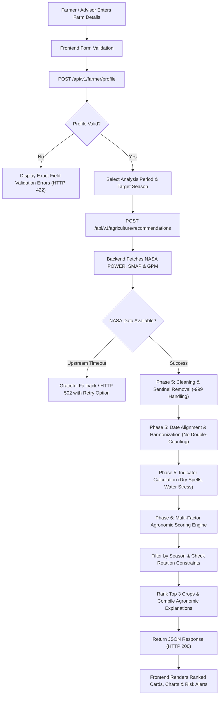

# Product Requirements Document (PRD)
## AgriShift AI: NASA-Powered Smart Agriculture & Crop Planning Platform

---

### Document Metadata
* **Document Version:** 1.0.0
* **Project Name:** AgriShift AI
* **Status:** Complete Backend Implementation (Phases 1–6 Completed & Tested; Frontend Decoupled)
* **Target Pilot Region:** Hooghly District, West Bengal, India (22.90°N, 88.40°E)
* **Author / Role:** Senior Product Manager & System Architect
* **Target Audience:** Frontend Developers, Agronomic Advisors, Extension Engineers, Stakeholders

---

## 1. Executive Summary

Smallholder farmers in the Global South face unprecedented vulnerability due to climate change, unseasonal rainfall anomalies, prolonged dry spells, and fluctuating soil moisture regimes. In districts like **Hooghly, West Bengal**—often celebrated as the "potato and rice bowl" of eastern India—traditional calendar-based sowing practices frequently lead to crop failure, disease outbreaks (e.g., Late Blight in potato), severe water stress, or catastrophic financial losses.

**AgriShift AI** is an intelligent, transparent agro-advisory backend service that bridges the critical gap between spaceborne Earth Observations and smallholder farm management. By ingesting, cleaning, and integrating high-resolution datasets from the **National Aeronautics and Space Administration (NASA)**—including **NASA POWER** (meteorology and radiation), **NASA SMAP** (satellite soil moisture), and **NASA GPM IMERG** (satellite precipitation)—AgriShift AI computes localized agro-ecological indicators and delivers rule-based, explainable crop recommendations for upcoming growing seasons.

The backend is built with **FastAPI** and **Pydantic**, providing a decoupled, stateless REST API architecture with 100% automated test coverage across its analytical pipelines.

---

## 2. Problem Statement

Smallholder farmers in Hooghly District confront interconnected agronomic challenges that cannot be resolved through intuition alone:

1. **Erratic Rainfall & Monsoon Onset Uncertainty:** Shifting monsoon windows and untimely pre-monsoon or winter showers disrupt traditional Kharif (Aman paddy) sowing and Rabi (Potato, Mustard) tuberization.
2. **Temperature Fluctuations & Heatwaves:** Unseasonal spikes in minimum winter temperatures inhibit potato tuberization (critical threshold > 28°C) and cause flower drop in mustard and pulses.
3. **Soil Moisture & Waterlogging Vulnerability:** Gangetic alluvial soils with high clay fractions suffer from compaction and waterlogging during high-intensity storms, triggering root rot and aeration deficits.
4. **Sub-optimal Crop Rotation & Monoculture Fatigue:** Monocropping potato or paddy consecutively depletes soil macronutrients and builds soil-borne fungal pathogens (e.g., *Phytophthora infestans*, *Ralstonia solanacearum*).
5. **Inaccessible Environmental Intelligence:** While NASA, NOAA, and IMD generate terabytes of climate data daily, it remains trapped in complex scientific formats (NetCDF4, HDF5, OPeNDAP, raw GRIB) inaccessible to farmers and local extension workers.

---

## 3. Product Vision

> **"Transform petabytes of NASA spaceborne observations into simple, transparent, and actionable agricultural decision support for smallholder farmers."**

AgriShift AI does **not** rely on "black-box" machine learning that outputs unsubstantiated crop predictions. Instead, it couples validated NASA Earth observation records with institutional agronomic knowledge codified by the **Indian Council of Agricultural Research (ICAR)** and **Bidhan Chandra Krishi Viswavidyalaya (BCKV)**. Every recommendation provides explicit agronomic justifications, climate risk alerts, water-stress diagnoses, and crop rotation constraints.

---

## 4. Target Users

| User Persona | Context & Needs | How AgriShift AI Serves Them |
|---|---|---|
| **Smallholder Farmer** | Manages 0.5 to 5.0 acres in rural Bengal. Limited technical knowledge; requires clear, visual advice on which crop to sow next season based on soil, irrigation, and recent weather. | Consumes simple UI dashboards showing Top 3 ranked crops, expected risks, and water needs. |
| **Agricultural Extension Officer (Krishi Projukti Sahayak - KPS)** | Government advisor guiding village clusters. Needs data-backed justification to advise farmers on crop diversification away from water-intensive Boro paddy. | Uses environmental analysis and indicator reports to back seasonal advisories. |
| **Agronomic Researcher / NGO** | Evaluates climate adaptation strategies in the Gangetic basin. Requires raw and cleaned satellite indicators, provenance tracking, and data completeness metrics. | Interacts with raw/cleaned API endpoints (`/agriculture/process`) for longitudinal climate audits. |
| **System Administrator** | Manages cloud uptime, API latency, NASA upstream rate limits, and configuration. | Inspects `/health`, `/docs`, and Earthdata authentication status. |

---

## 5. Core Features

The following table itemizes all functional modules within AgriShift AI, identifying input, processing, output, dependencies, and implementation status.

| Feature Module | Purpose | User / System Inputs | Processing Logic | Expected Outputs | Dependencies | Implementation Status |
|---|---|---|---|---|---|:---:|
| **1. Farmer Profile Management** | Validate and ingest farm characteristics, coordinates, soil type, and cropping history. | Village, Lat/Lon, land area, current crop, past crop, soil type, irrigation, season. | Validates ranges (Lat: -90..90, Lon: -180..180, Area > 0), sanitizes strings. | Validated Pydantic model (`FarmerProfileResponse`). | FastAPI, Pydantic | **IMPLEMENTED & TESTED** |
| **2. NASA POWER Integration** | Fetch daily solar radiation, 2m air temp, precipitation, and relative humidity. | Latitude, Longitude, Start Date, End Date (default: last 30 days accounting for 4-day lag). | HTTP GET to NASA POWER Daily Point API, parsing agro-climatology parameters (`T2M`, `PRECTOTCORR`, `RH2M`, `ALLSKY_SFC_SW_DWN`). | Daily time series, mean/min/max temperature, total rain, solar radiation in kWh/m²/day. | `requests`, NASA POWER API | **IMPLEMENTED & TESTED** |
| **3. NASA SMAP Integration** | Ingest satellite-derived root-zone and surface soil wetness. | Latitude, Longitude, Start Date, End Date. | Queries SMAP Level-4 Land Surface Model parameters (`GWETTOP`, `GWETROOT`, `GWETPROF`), converts wetness fractions. | Daily soil moisture fractions (0.0–1.0) and percentages (0–100%), drying/wetting trends. | NASA POWER GMAO GEOS API | **IMPLEMENTED & TESTED** |
| **4. NASA GPM IMERG Discovery** | Locate high-resolution satellite precipitation granules. | Latitude, Longitude, ISO Start Date, ISO End Date. | Queries NASA Earthdata CMR API (`GPM_3IMERGDF` v07) for coordinate bounding points. | Granule count, temporal coverage, metadata URLs. | NASA CMR API | **IMPLEMENTED & TESTED** |
| **5. NASA GPM OPeNDAP Retrieval** | Retrieve gridded daily rainfall slices from NASA GES DISC. | CMR Granule links, Earthdata Login credentials (`.env`). | Authenticated requests to OPeNDAP endpoints. Gracefully flags requirement if unconfigured. | Calibrated daily precipitation records (`mm/day`). | Earthdata URS, GES DISC OPeNDAP | **PARTIALLY IMPLEMENTED** *(Granule search live; OPeNDAP authenticated download stubbed)* |
| **6. Data Cleaning Pipeline (Phase 5)** | Detect missing data, handle NASA sentinels (`-999.0`), sanitize extreme values. | Raw daily data from POWER, SMAP, and GPM. | Replaces sentinel values with `None` (never `0.0`), flags extreme heat (>42°C) or downpours (>100mm) without silent deletion. | Cleaned records, data quality flags, data completeness percentage. | `data_cleaner.py` | **IMPLEMENTED & TESTED** |
| **7. Data Integration Pipeline (Phase 5)** | Align disparate data streams by calendar date and farm coordinates without double-counting. | Cleaned satellite datasets, preferred rainfall source selector. | Dates aligned across YYYY-MM-DD. Rainfall harmonized to prevent double-counting between POWER and GPM. | Integrated dataset, harmonized daily records, full source provenance tracking. | `data_integrator.py` | **IMPLEMENTED & TESTED** |
| **8. Agricultural Indicator Engine** | Calculate actionable agronomic indicators from integrated records. | Integrated daily time series. | Computes consecutive dry days, rainfall trend, temperature trend, soil moisture trend, water-stress classification. | Summary dictionary containing categorized agro-climatic indicators. | `indicator_calculator.py` | **IMPLEMENTED & TESTED** |
| **9. Crop Recommendation Engine (Phase 6)** | Rank crops and generate explainable agronomic advisories for Hooghly. | Farmer profile + Processed environmental indicators + Target season. | Multi-factor weighted rule engine (Season: 25%, Temp: 20%, Water: 20%, Soil: 15%, Moisture: 10%, Rotation: 10%). | Top 3 ranked crops, suitability scores (0–100), advantages, agronomic risks, rotation warnings. | `recommendation_engine.py`, `crop_knowledge_base.py` | **IMPLEMENTED & TESTED** |
| **10. Interactive Frontend Dashboard** | Provide accessible web interface for farmers and advisors. | User form inputs, filter buttons. | Calls backend REST endpoints, formats Plotly charts, renders recommendation cards. | Multi-page responsive web dashboard. | React / Vue / Streamlit | **PLANNED** *(Ready for frontend developer)* |

---

## 6. Farmer Input Requirements

The backend enforces strict validation rules on all incoming farmer and plot parameters:

### 6.1 Mandatory Fields
| Field Name | Type | Constraints / Validation | Example Value | Description |
|---|---|---|---|---|
| `village` | `string` | Min length: 1 character | `"Singur"` | Village or Gram Panchayat in Hooghly. |
| `latitude` | `float` | `-90.0 <= lat <= 90.0` | `22.81` | Geographic latitude in decimal degrees. |
| `longitude` | `float` | `-180.0 <= lon <= 180.0` | `88.23` | Geographic longitude in decimal degrees. |
| `current_crop` | `string` | Min length: 1 character | `"Potato"` | Standing or recently harvested crop. |
| `previous_crop` | `string` | Min length: 1 character | `"Paddy (Aman)"` | Crop harvested prior to current crop (used for rotation checks). |
| `soil_type` | `string` | Min length: 1 character | `"Alluvial"` | Dominant soil classification (Alluvial, Clayey, Loamy, Sandy Loam). |
| `land_area_acres` | `float` | `> 0.0` (Must be positive) | `2.5` | Operational landholding size in acres. |
| `irrigation_available` | `boolean` | `true` or `false` | `true` | Whether farmer has assured irrigation access (canal, shallow tube-well). |
| `farming_season` | `string` | Min length: 1 character | `"Rabi"` | Current active agricultural season. |

### 6.2 Optional Fields
| Field Name | Type | Default Value | Description |
|---|---|---|---|
| `farmer_id` | `string` | `null` | Optional unique identifier for registered farmers. |
| `name` | `string` | `null` | Farmer's full name. |
| `district` | `string` | `"Hooghly"` | Target district in West Bengal. |
| `state` | `string` | `"West Bengal"` | State. |
| `target_farming_season` | `string` | Matches `farming_season` | Target season for crop recommendation (e.g. Rabi, Kharif, Boro, Zaid). |
| `preferred_rainfall_source` | `string` | `"NASA POWER"` | Preferred rainfall dataset (`"NASA POWER"` or `"NASA GPM IMERG"`). |
| `start_date` | `string` | 30 days prior to end date | Observation start date (`YYYY-MM-DD`). |
| `end_date` | `string` | Current date minus lag | Observation end date (`YYYY-MM-DD`). |

---

## 7. User Journey

### Edge & Failure Handling Scenarios:
1. **Invalid Coordinates:** If a user enters latitude `105.0`, the backend returns HTTP 422 with `Input should be less than or equal to 90`.
2. **Missing Satellite Observations:** If NASA satellites experienced sensor degradation or cloud blinding, raw `-999.0` sentinels are converted to `null`. The backend calculates a `data_completeness_percentage`. If completeness is below 50%, recommendations include explicit data quality warnings.
3. **Monoculture Detection:** If a farmer selects `Potato` as current crop and `Potato` as previous crop, the recommendation engine detects monoculture and applies a heavy rotational penalty (-80% of rotation weight) to solanaceous crops, warning against Late Blight build-up.
4. **Rainfed High-Water Sowing:** If a farmer has `irrigation_available: false` and targets Rabi season, water-intensive crops (Potato, Boro Rice) receive zero water scores, preventing unviable crop recommendations.

---

## 8. Functional Requirements

* **FR-01 (Profile Intake):** The system SHALL accept and validate farmer profile parameters via `POST /api/v1/farmer/profile` according to geographic and agronomic constraints.
* **FR-02 (POWER Meteorology):** The system SHALL retrieve daily temperature, precipitation, humidity, and solar radiation from NASA POWER for coordinates within (-90..90, -180..180).
* **FR-03 (SMAP Soil Moisture):** The system SHALL extract surface (0–5 cm) and root-zone (0–100 cm) soil wetness fractions from the NASA GMAO Catchment model.
* **FR-04 (GPM Granule Discovery):** The system SHALL query NASA CMR search for `GPM_3IMERGDF` daily granules intersecting user coordinates.
* **FR-05 (Sentinel Sanitization):** The system SHALL detect NASA `-999.0` and `<= -900.0` sentinel fill values and replace them with `null`, strictly forbidding replacing missing observations with `0.0`.
* **FR-06 (Double-Counting Prevention):** The system SHALL harmonize rainfall between NASA POWER and GPM IMERG using a prioritized single-source attribution method.
* **FR-07 (Dry Spell Computation):** The system SHALL calculate maximum consecutive dry days (< 1.0 mm/day) and total dry days across the observation period.
* **FR-08 (Water-Stress Diagnosis):** The system SHALL evaluate root-zone wetness into one of four scientific categories: Severe Stress (<=0.20), Moderate Stress (<=0.40), Optimal (0.40–0.75), or Waterlogging (>0.75).
* **FR-09 (Crop Suitability Scoring):** The system SHALL evaluate crops against 6 weighted agronomic criteria totaling 100 points: Season (25), Temperature (20), Water/Irrigation (20), Soil (15), Soil Moisture (10), Rotation (10).
* **FR-10 (Rotation Enforcement):** The system SHALL check preceding crops against botanical families and penalize solanaceous monoculture or consecutive high-depletion feeders.
* **FR-11 (Recommendation Output):** The system SHALL rank all evaluated crops and return the Top 3 candidates accompanied by suitability scores, reasons, risks, and water management guidance.
* **FR-12 (Data Provenance):** The system SHALL report the exact data source, resolution, and observation date for every parameter in the response payload.

---

## 9. Non-Functional Requirements

* **NFR-01 (Performance):** The backend SHALL process agricultural requests and compute recommendations within < 3.5 seconds when external NASA APIs respond within normal latency (< 2.0s).
* **NFR-02 (Stateless Reliability):** The backend SHALL remain completely stateless, requiring no persistent database to execute end-to-end processing and recommendations.
* **NFR-03 (Security & Confidentiality):** Under NO circumstances SHALL upstream credentials (`EARTHDATA_USERNAME`, `EARTHDATA_PASSWORD`) be printed to console logs, error traces, or serialized into JSON API responses.
* **NFR-04 (Test Coverage):** Every analytical pipeline component SHALL be covered by automated unit/integration tests with a 100% test pass rate (minimum 75 automated tests maintained).
* **NFR-05 (Documentation Availability):** Interactive OpenAPI / Swagger UI documentation SHALL be automatically served at `/docs` and `/redoc` on any active instance.
* **NFR-06 (Data Integrity):** The system SHALL never fabricate or simulate environmental measurements. If NASA upstream data is unavailable, it must report missing data transparently.
* **NFR-07 (CORS Support):** The backend SHALL configure Cross-Origin Resource Sharing (CORS) headers to allow seamless integration from decoupled frontend clients running on localhost or web domains.

---

## 10. Limitations and Future Scope

### What the System Currently Guarantees:
1. Accurate mathematical cleaning and sentinel removal of NASA records.
2. Verified agronomic crop requirements for Hooghly backed by ICAR and BCKV documentation.
3. Transparent, deterministic rule scoring (no unpredictable deep-learning hallucination).
4. Prevention of double-counted rainfall.

### What the System Cannot Guarantee:
1. **Micro-topography Anomalies:** NASA satellite grid cells (~10 km to 50 km) cannot account for sub-acre micro-drainage variations or localized shade trees.
2. **Upstream Latency:** NASA POWER operates on a 4-day publication latency; GPM Final has a ~3.5-month latency (Late Run has ~14 hours).
3. **Market Price Guarantees:** AgriShift AI evaluates bio-physical and agro-climatic suitability, not real-time APMC mandi commodity prices.

### Future Scope (Phases 8+):
* Integration of real-time mandi price forecasts (e.g., e-NAM API) to weigh profitability against agronomic suitability.
* Localized pest and disease risk modeling driven by high relative humidity alerts (>85% RH + cool temperatures).
* Multilingual voice-driven UI support in Bengali and Hindi for farmers with limited literacy.
* Offline Progressive Web App (PWA) caching for low-connectivity rural zones.